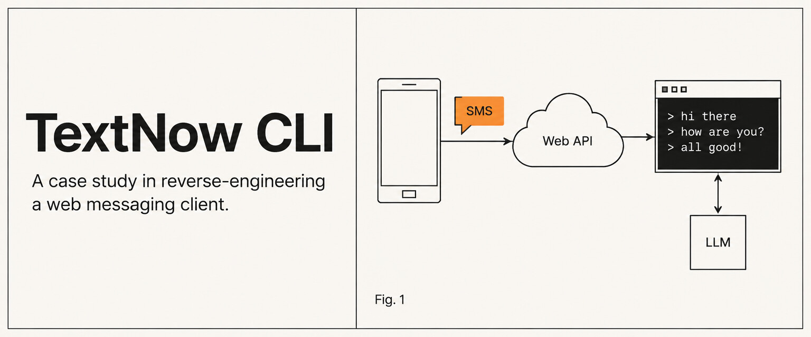
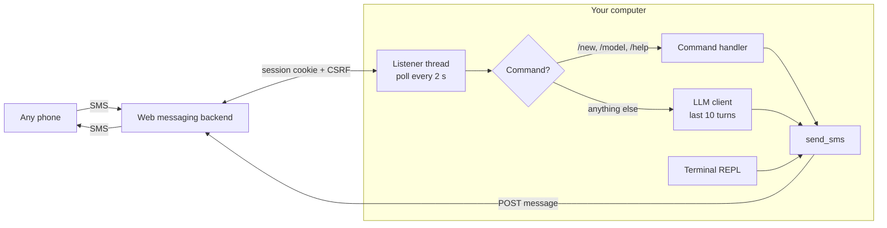

<p align="center">
  
</p>

<h1 align="center">TextNow CLI</h1>

<p align="center">
  An unofficial case study: how a web messaging app talks to its backend, and how far a small Python client can take it, all the way to an SMS chatbot.
</p>

<p align="center">
  <a href="#what-i-wanted-to-learn">Goal</a> ·
  <a href="#what-i-found">Findings</a> ·
  <a href="#architecture">Architecture</a> ·
  <a href="#lessons">Lessons</a> ·
  <a href="#running-it">Running it</a>
</p>

<p align="center">
  
</p>

> **Educational project.** This is an independent study of how a public web app works. It is not affiliated with, endorsed by, or supported by TextNow. It uses only your own logged-in session on your own account, makes no attempt to bypass rate limits or access other users' data, and the undocumented API it relies on can change or break at any time. Automating your account may go against the service's terms; read them before running anything here, and do not use it to send bulk or unsolicited messages.

## What I wanted to learn

TextNow gives you a free phone number that works in a browser. I wanted to know three things:

1. What does the browser actually send when you read and send a text?
2. Could a terminal client do the same with nothing but my own session?
3. Could that turn a phone number into an interface for an LLM, so I can text a model from any phone, with no app and no data plan beyond SMS?

## What I found

Watching the browser's network tab while using the web app showed a small, conventional REST surface:

| Action | Request |
|---|---|
| List messages | `GET /api/users/{username}/messages` (newest first) |
| One conversation | same endpoint with a contact filter and a limit |
| Send a text | `POST /api/users/{username}/messages`, form-encoded: contact, body, direction, type |

Authentication is the browser session itself: a session cookie plus a CSRF token, both readable from DevTools after logging in. There is no public API key or OAuth flow.

Two details were not obvious and cost the most time:

- **Message direction is labelled from the contact's point of view.** A message *from* the contact to you is marked direction `1` ("outgoing"), and a message you send is `2`. The client names these constants explicitly so the inverted meaning is documented in one place.
- **There is no push channel to hook into.** New messages have to be found by polling. The client remembers the highest message ID it has seen and treats anything above it as new, which avoids timestamp parsing and time-zone bugs entirely.

## Architecture



| File | Role |
|---|---|
| `textnow_cli/client.py` | Session setup, `send_sms`, `get_new_messages` (ID high-water mark), `get_conversation` |
| `textnow_cli/main.py` | Terminal REPL plus a background listener thread that auto-replies |
| `textnow_cli/chatgpt.py` | Rolling 10-message context, model switching, session reset |
| `textnow_cli/config.py` | Reads credentials from `.env` |

**Two loops, one session.** The terminal REPL lets you type and send messages directly. A daemon thread polls every two seconds, backs off to five seconds after an error, and answers texts from the configured number.

**Texting a model.** Messages starting with `/` are commands handled locally (`/new` resets context, `/model 4o` or `/model o3` switches models). Everything else goes to the LLM with the last ten turns as context, and the reply is sent back as an SMS.

## Lessons

- **The network tab is the documentation.** For a site without a public API, watching real requests for a few minutes tells you more than any guesswork.
- **Prefer IDs over timestamps for "what's new".** A monotonic ID turned "find new messages since last poll" into one comparison.
- **Name surprising constants.** The inverted direction flag would have been a recurring bug without `DIRECTION_OUTGOING = 1  # when contact sends to us`.
- **Keep chat context bounded.** Ten turns was enough for SMS-length conversations and kept each request small and cheap.
- **Unofficial means fragile.** Session cookies expire, endpoints move, and bot protection changes. Anything built this way should be treated as an experiment, not a product.

## Running it

For learning and personal experimentation only.

```sh
cd textnow_cli
pip install -r requirements.txt
# create .env with the four values below
python main.py
```

```sh
TEXTNOW_USERNAME=your_username
TEXTNOW_SID_COOKIE=...     # connect.sid cookie from your own logged-in browser session
TEXTNOW_CSRF_TOKEN=...     # _csrf cookie
OPENAI_API_KEY=...
```

Terminal commands: `/help`, `/history`, `/status`, `/exit`. Phone commands: `/new`, `/model 4o`, `/model o3`, `/help`.

Treat the cookie values like a password: anyone holding them can act as you until the session expires.

## Tech stack

Python 3, `cloudscraper` (a `requests` session wrapper), `python-dotenv`, OpenAI Python SDK.

## License

MIT. TextNow is a trademark of its owner, used here only to describe what the code interacts with.
